# Somali Multi-Vendor Marketplace
# Database Design & Entity Relationship Diagram

**Project:** SIMAD iLab Somalia 10X Challenge — Project 10  
**Database:** PostgreSQL  
**ORM:** Prisma  
**Architecture:** Next.js App Router, TypeScript  
**Status:** Proposed design — review before implementation  
**Currency:** USD

---

## 1. Purpose

This document defines the database structure for the Somali Multi-Vendor Marketplace.

The database must support:

- Separate customer, vendor and admin accounts.
- Email/password authentication and Amazon sign-in for customers and vendors.
- Stronger admin-only authentication and security.
- Vendor registration, onboarding and admin approval.
- Product catalogues, variants, SKUs and inventory.
- Shopping carts and multi-vendor checkout.
- Atomic 10-minute stock reservations.
- One parent order with one sub-order per vendor.
- Simulated Somali mobile-money payment methods.
- Platform and vendor-funded coupons.
- Percentage-based platform commission.
- Returns, refunds, vendor ledgers and payouts.
- Product reviews.
- Customer-to-vendor video calls.
- Notifications, audit logs and administrative reporting.

The design prioritizes data integrity, transaction safety, security and maintainability.

## 2. Core design principles

1. Use PostgreSQL as the source of truth.
2. Use UUID primary keys.
3. Use foreign keys to maintain relationships.
4. Use database transactions for checkout, reservations, payments and financial entries.
5. Use `DECIMAL`/PostgreSQL `NUMERIC` for money, never floating-point types.
6. Store timestamps in UTC.
7. Use enums for controlled statuses.
8. Preserve historical prices, commission rates and order details as snapshots.
9. Never delete expired reservations without first releasing reserved inventory.
10. Keep financial ledger entries append-only.
11. Enforce authorization on the server, not only in the interface.

## 3. Account and authentication architecture

There are three distinct account types:

| Account type | Authentication | Registration |
|---|---|---|
| Customer | Email/password or Amazon | Public |
| Vendor | Email/password or Amazon | Separate vendor registration |
| Admin | Email/password, email OTP and authenticator-app MFA | No public registration |

A customer cannot convert their account into a vendor account. Customer and vendor accounts are separate identities, even if the same email address is used.

Amazon identity connections must never automatically merge customer and vendor accounts.

### Admin security rules

- Ten-minute inactivity timeout.
- Reauthentication after 24 hours.
- Email OTP verification.
- Authenticator-app MFA (TOTP).
- Single-use recovery codes.
- Rate limiting and suspicious-login protection.
- Audit logging for sensitive administrative actions.

### Customer and vendor security rules

- Normal session expiration policy.
- Email verification.
- CAPTCHA protection against automated registration and login abuse.
- Secure password hashing.
- Rate limiting against repeated login attempts.

The ten-minute admin session timeout is unrelated to the ten-minute stock reservation timeout.

## 4. Database entities

### A. Users and authentication

#### `users`

Stores the identity of every customer, vendor and admin.

| Field | Type | Description |
|---|---|---|
| id | UUID, PK | User identifier |
| email | VARCHAR | Email address |
| accountType | ENUM | CUSTOMER, VENDOR, ADMIN |
| emailVerifiedAt | TIMESTAMP, nullable | Email verification time |
| isActive | BOOLEAN | Account enabled |
| createdAt | TIMESTAMP | Creation time |
| updatedAt | TIMESTAMP | Last update |

**Constraints:**
- Unique `(accountType, email)` using normalized email.
- One account type per user.
- Do not automatically merge accounts with matching email addresses.

#### `user_auth_accounts`

Stores authentication credentials and external identity connections.

| Field | Type | Description |
|---|---|---|
| id | UUID, PK | Authentication record |
| userId | UUID, FK | Associated user |
| provider | ENUM | LOCAL, AMAZON |
| providerAccountId | VARCHAR, nullable | External provider identity |
| passwordHash | VARCHAR, nullable | Password hash for LOCAL |
| createdAt | TIMESTAMP | Creation time |
| updatedAt | TIMESTAMP | Last update |

**Constraints:**
- Unique `(provider, providerAccountId)` when an external provider ID exists.
- A user can have a local login and an Amazon login.
- Only CUSTOMER and VENDOR accounts can use Amazon.
- Passwords must be hashed with Argon2id or bcrypt.
- Never store plaintext passwords.

#### `user_sessions`

Tracks authenticated sessions.

| Field | Type | Description |
|---|---|---|
| id | UUID, PK | Session ID |
| userId | UUID, FK | Account owner |
| sessionTokenHash | VARCHAR | Hashed session token |
| lastActivityAt | TIMESTAMP | Last activity |
| expiresAt | TIMESTAMP | Expiration |
| revokedAt | TIMESTAMP, nullable | Revocation time |
| createdAt | TIMESTAMP | Creation time |

Admin inactivity and maximum session age must be checked server-side on every protected request.

#### `email_verification_codes`

Stores email verification and OTP challenges.

| Field | Type | Description |
|---|---|---|
| id | UUID, PK | Verification ID |
| userId | UUID, FK | User |
| codeHash | VARCHAR | Hashed OTP |
| purpose | ENUM | EMAIL_VERIFY, ADMIN_LOGIN, PASSWORD_RESET |
| expiresAt | TIMESTAMP | Expiration |
| usedAt | TIMESTAMP, nullable | Consumption time |
| createdAt | TIMESTAMP | Creation time |

OTP values must be short-lived, rate-limited and single-use.

#### `admin_mfa_methods`

Stores administrator MFA enrollment.

| Field | Type | Description |
|---|---|---|
| id | UUID, PK | MFA record |
| userId | UUID, FK | Admin user |
| encryptedSecret | TEXT | Encrypted TOTP secret |
| enabled | BOOLEAN | MFA status |
| verifiedAt | TIMESTAMP, nullable | Enrollment verification |
| createdAt | TIMESTAMP | Creation time |

Only ADMIN accounts may enroll an MFA method. The TOTP secret must be encrypted at rest.

#### `admin_recovery_codes`

Stores one-time administrator recovery codes.

| Field | Type | Description |
|---|---|---|
| id | UUID, PK | Recovery code ID |
| userId | UUID, FK | Admin user |
| codeHash | VARCHAR | Hashed recovery code |
| usedAt | TIMESTAMP, nullable | Consumption time |
| createdAt | TIMESTAMP | Creation time |

Recovery codes must be single-use and stored as hashes.

#### `login_attempts`

Tracks login activity and suspicious attempts.

| Field | Type | Description |
|---|---|---|
| id | UUID, PK | Attempt ID |
| userId | UUID, FK, nullable | Associated user |
| identifier | VARCHAR | Submitted login identifier |
| ipAddress | VARCHAR | Source address |
| successful | BOOLEAN | Result |
| attemptedAt | TIMESTAMP | Attempt time |

Avoid storing passwords, OTPs or authentication secrets in this table.

#### `audit_logs`

Tracks sensitive actions.

| Field | Type | Description |
|---|---|---|
| id | UUID, PK | Audit ID |
| actorUserId | UUID, FK, nullable | Actor |
| action | VARCHAR | Action name |
| entityType | VARCHAR | Affected entity |
| entityId | UUID, nullable | Affected record |
| metadata | JSONB | Safe contextual details |
| createdAt | TIMESTAMP | Event time |

Examples include vendor approval, commission changes, refunds, payout processing and admin account changes.

---

### B. Vendors and markets

#### `vendors`

Stores vendor profiles independently of authentication.

| Field | Type | Description |
|---|---|---|
| id | UUID, PK | Vendor ID |
| userId | UUID, FK, unique | Vendor account |
| storeName | VARCHAR | Store name |
| description | TEXT | Store description |
| phone | VARCHAR | Contact number |
| address | TEXT | Store address |
| approvalStatus | ENUM | PENDING, APPROVED, REJECTED, SUSPENDED |
| approvedBy | UUID, FK, nullable | Admin who approved |
| approvedAt | TIMESTAMP, nullable | Approval date |
| createdAt | TIMESTAMP | Creation time |
| updatedAt | TIMESTAMP | Last update |

A vendor can access a limited onboarding dashboard while PENDING.

Only APPROVED vendors can publish products, receive orders and sell.

#### `markets`

Stores physical market discovery locations.

| Field | Type | Description |
|---|---|---|
| id | UUID, PK | Market ID |
| name | VARCHAR | Market name |
| city | VARCHAR, nullable | City |
| region | VARCHAR, nullable | Region |
| description | TEXT | Market description |
| isActive | BOOLEAN | Visibility |
| createdAt | TIMESTAMP | Creation time |

#### `vendor_markets`

Connects vendors with their market locations.

| Field | Type | Description |
|---|---|---|
| id | UUID, PK | Relationship ID |
| vendorId | UUID, FK | Vendor |
| marketId | UUID, FK | Market |

Unique `(vendorId, marketId)`.

Market information must be verified before real records are seeded.

---

### C. Products and inventory

#### `categories`

Stores product categories.

| Field | Type | Description |
|---|---|---|
| id | UUID, PK | Category ID |
| name | VARCHAR | Category name |
| slug | VARCHAR, unique | URL slug |
| parentId | UUID, FK, nullable | Parent category |
| isActive | BOOLEAN | Visibility |

#### `products`

Stores products owned by vendors.

| Field | Type | Description |
|---|---|---|
| id | UUID, PK | Product ID |
| vendorId | UUID, FK | Product owner |
| categoryId | UUID, FK | Category |
| name | VARCHAR | Product name |
| slug | VARCHAR | URL slug |
| description | TEXT | Product details |
| status | ENUM | DRAFT, PENDING, ACTIVE, REJECTED, ARCHIVED |
| createdAt | TIMESTAMP | Creation time |
| updatedAt | TIMESTAMP | Last update |

Only products belonging to approved vendors may be made available for sale.

#### `product_variants`

Stores purchasable product options.

| Field | Type | Description |
|---|---|---|
| id | UUID, PK | Variant ID |
| productId | UUID, FK | Product |
| sku | VARCHAR, unique | Stock keeping unit |
| attributes | JSONB | Size, color or other options |
| price | NUMERIC(12,2) | Selling price |
| stockOnHand | INTEGER | Physical stock |
| reservedQuantity | INTEGER | Reserved stock |
| isActive | BOOLEAN | Availability |
| createdAt | TIMESTAMP | Creation time |
| updatedAt | TIMESTAMP | Last update |

Available stock:

`availableQuantity = stockOnHand - reservedQuantity`

The available quantity is calculated, not independently stored.

Database constraints must prevent negative stock and reserved quantity greater than stock on hand.

Inventory updates must use transactions and conditional updates or row locking to prevent overselling.

---

### D. Shopping cart and reservations

#### `carts`

Stores customer shopping carts.

| Field | Type | Description |
|---|---|---|
| id | UUID, PK | Cart ID |
| customerId | UUID, FK | Customer |
| status | ENUM | ACTIVE, CONVERTED, ABANDONED |
| createdAt | TIMESTAMP | Creation time |
| updatedAt | TIMESTAMP | Last update |

#### `cart_items`

Stores products added to carts.

| Field | Type | Description |
|---|---|---|
| id | UUID, PK | Cart item ID |
| cartId | UUID, FK | Cart |
| variantId | UUID, FK | Product variant |
| quantity | INTEGER | Requested quantity |
| createdAt | TIMESTAMP | Creation time |
| updatedAt | TIMESTAMP | Last update |

Adding an item to a cart does not reserve stock.

#### `reservations`

Stores checkout inventory reservations.

| Field | Type | Description |
|---|---|---|
| id | UUID, PK | Reservation ID |
| customerId | UUID, FK | Customer |
| orderId | UUID, FK, nullable | Created order |
| status | ENUM | ACTIVE, CONVERTED, EXPIRED, CANCELLED |
| expiresAt | TIMESTAMP | Expiration time |
| createdAt | TIMESTAMP | Reservation time |
| updatedAt | TIMESTAMP | Last update |

Reservation starts when the customer confirms checkout details.

Expiration is ten minutes after reservation creation.

#### `reservation_items`

Stores each reserved product variant.

| Field | Type | Description |
|---|---|---|
| id | UUID, PK | Reservation item ID |
| reservationId | UUID, FK | Reservation |
| variantId | UUID, FK | Product variant |
| quantity | INTEGER | Reserved quantity |

**Reservation transaction rules:**

1. Begin a database transaction.
2. Lock or conditionally update the requested product variants.
3. Verify sufficient available stock.
4. Increase reserved quantities.
5. Create the reservation and reservation items.
6. Create the parent order and vendor sub-orders.
7. Commit the transaction.

If any required item cannot be reserved, roll back the entire checkout.

A background worker must periodically find expired ACTIVE reservations. It must atomically reduce each variant's reserved quantity and mark the reservation EXPIRED.

Do not rely on automatic row deletion or a database TTL feature to release inventory.

---

### E. Orders and payments

#### `orders`

Stores one parent order per customer checkout.

| Field | Type | Description |
|---|---|---|
| id | UUID, PK | Order ID |
| customerId | UUID, FK | Customer |
| reservationId | UUID, FK, nullable | Checkout reservation |
| orderNumber | VARCHAR, unique | Public order reference |
| status | ENUM | PENDING_PAYMENT, PAID, PROCESSING, COMPLETED, CANCELLED, PARTIALLY_REFUNDED, REFUNDED |
| subtotal | NUMERIC(12,2) | Items subtotal |
| discountTotal | NUMERIC(12,2) | Total discounts |
| deliveryTotal | NUMERIC(12,2) | Delivery charges |
| totalAmount | NUMERIC(12,2) | Amount payable |
| currency | VARCHAR(3) | USD |
| createdAt | TIMESTAMP | Creation time |
| updatedAt | TIMESTAMP | Last update |

One parent order represents the complete customer checkout.

#### `sub_orders`

Stores one sub-order per vendor within a parent order.

| Field | Type | Description |
|---|---|---|
| id | UUID, PK | Sub-order ID |
| orderId | UUID, FK | Parent order |
| vendorId | UUID, FK | Vendor |
| subOrderNumber | VARCHAR, unique | Vendor order reference |
| status | ENUM | AWAITING_VENDOR, CONFIRMED, PROCESSING, SHIPPED, DELIVERED, CANCELLED, RETURN_REQUESTED, PARTIALLY_REFUNDED, REFUNDED |
| subtotal | NUMERIC(12,2) | Vendor items subtotal |
| deliveryFee | NUMERIC(12,2) | Vendor delivery allocation |
| discountAmount | NUMERIC(12,2) | Allocated discount |
| commissionRate | NUMERIC(5,2) | Commission percentage snapshot |
| commissionAmount | NUMERIC(12,2) | Commission snapshot |
| vendorPayable | NUMERIC(12,2) | Amount payable before subsequent adjustments |
| vendorConfirmedAt | TIMESTAMP, nullable | Vendor confirmation |
| createdAt | TIMESTAMP | Creation time |
| updatedAt | TIMESTAMP | Last update |

The vendor must confirm the order within the required 24-hour confirmation window.

A vendor must only manage their own sub-orders.

#### `order_items`

Stores purchased item snapshots.

| Field | Type | Description |
|---|---|---|
| id | UUID, PK | Order item ID |
| subOrderId | UUID, FK | Vendor sub-order |
| variantId | UUID, FK, nullable | Original product variant |
| productNameSnapshot | VARCHAR | Name at purchase |
| skuSnapshot | VARCHAR | SKU at purchase |
| variantSnapshot | JSONB | Purchased options |
| unitPrice | NUMERIC(12,2) | Price at purchase |
| quantity | INTEGER | Purchased quantity |
| lineTotal | NUMERIC(12,2) | Item total |

Snapshots preserve historical order information even if a product is later edited or deleted.

#### `payments`

Stores checkout payment attempts.

| Field | Type | Description |
|---|---|---|
| id | UUID, PK | Payment ID |
| orderId | UUID, FK | Parent order |
| provider | ENUM | EVC_PLUS, ZAAD, EDAHAB, GOLIS |
| transactionReference | VARCHAR, nullable | Simulated transaction reference |
| idempotencyKey | VARCHAR, unique | Prevents duplicate processing |
| amount | NUMERIC(12,2) | Payment amount |
| status | ENUM | PENDING, SUCCESS, FAILED, EXPIRED, REFUNDED |
| paidAt | TIMESTAMP, nullable | Successful payment time |
| createdAt | TIMESTAMP | Creation time |

The checkout should have one successful payment for the full parent order. Failed attempts can be retained for audit and retry.

Payment methods are simulated for this challenge; this design does not imply real provider integrations.

---

### F. Coupons and discount allocation

#### `coupons`

Stores discount campaigns.

| Field | Type | Description |
|---|---|---|
| id | UUID, PK | Coupon ID |
| code | VARCHAR, unique | Coupon code |
| discountType | ENUM | PERCENTAGE, FIXED |
| discountValue | NUMERIC(12,2) | Discount value |
| fundingType | ENUM | PLATFORM, VENDOR |
| vendorId | UUID, FK, nullable | Funding vendor, when vendor-funded |
| maxDiscount | NUMERIC(12,2), nullable | Discount cap |
| startsAt | TIMESTAMP | Campaign start |
| expiresAt | TIMESTAMP | Campaign expiry |
| usageLimit | INTEGER, nullable | Maximum usage |
| isActive | BOOLEAN | Availability |

#### `coupon_redemptions`

Stores coupon use per parent order.

| Field | Type | Description |
|---|---|---|
| id | UUID, PK | Redemption ID |
| couponId | UUID, FK | Coupon |
| orderId | UUID, FK | Parent order |
| customerId | UUID, FK | Customer |
| totalDiscount | NUMERIC(12,2) | Total applied discount |
| createdAt | TIMESTAMP | Redemption time |

#### `coupon_redemption_allocations`

Allocates a coupon discount to individual vendor sub-orders.

| Field | Type | Description |
|---|---|---|
| id | UUID, PK | Allocation ID |
| redemptionId | UUID, FK | Redemption |
| subOrderId | UUID, FK | Vendor sub-order |
| fundingType | ENUM | PLATFORM, VENDOR |
| vendorId | UUID, FK, nullable | Funding vendor |
| amount | NUMERIC(12,2) | Allocated discount |

This table is important because a checkout may contain products from multiple vendors.

**Financial rule:**
- Platform-funded discounts do not reduce vendor earnings.
- Vendor-funded discounts reduce the funding vendor's earnings.
- Discount allocations must be calculated and preserved when the order is created.

---

### G. Returns and refunds

#### `returns`

Stores return requests.

| Field | Type | Description |
|---|---|---|
| id | UUID, PK | Return ID |
| subOrderId | UUID, FK | Vendor sub-order |
| customerId | UUID, FK | Customer |
| status | ENUM | REQUESTED, APPROVED, REJECTED, RECEIVED, REFUNDED, CANCELLED |
| reason | TEXT | Return reason |
| requestedAt | TIMESTAMP | Request date |
| reviewedBy | UUID, FK, nullable | Reviewing admin or vendor user |
| reviewedAt | TIMESTAMP, nullable | Review date |

Return requests must be submitted within the proposed seven-day return window, subject to the final published return policy.

The approval workflow is vendor review with admin override or dispute handling.

#### `return_items`

Stores the items included in a return.

| Field | Type | Description |
|---|---|---|
| id | UUID, PK | Return item ID |
| returnId | UUID, FK | Return |
| orderItemId | UUID, FK | Purchased item |
| quantity | INTEGER | Quantity being returned |
| refundAmount | NUMERIC(12,2) | Item refund amount |

Refunds must be reflected in the financial ledger and payment records. A partial return must not refund the entire parent order.

---

### H. Financial ledger and payouts

#### `platform_settings`

Stores platform-wide settings.

| Field | Type | Description |
|---|---|---|
| id | UUID, PK | Setting ID |
| commissionRate | NUMERIC(5,2) | Global percentage commission |
| updatedBy | UUID, FK | Admin |
| updatedAt | TIMESTAMP | Update time |

The commission rate is controlled by the admin. The rate applied to an order is copied into its sub-order so historical calculations do not change when the platform rate is updated.

#### `ledger_entries`

Stores append-only financial movements.

| Field | Type | Description |
|---|---|---|
| id | UUID, PK | Ledger entry ID |
| vendorId | UUID, FK | Vendor |
| subOrderId | UUID, FK, nullable | Related sub-order |
| returnId | UUID, FK, nullable | Related return |
| payoutId | UUID, FK, nullable | Related payout |
| entryType | ENUM | SALE_CREDIT, COMMISSION_DEBIT, VENDOR_DISCOUNT_DEBIT, REFUND_DEBIT, PAYOUT_DEBIT, ADJUSTMENT |
| amount | NUMERIC(12,2) | Positive magnitude |
| currency | VARCHAR(3) | USD |
| reference | VARCHAR | Reference |
| createdAt | TIMESTAMP | Entry time |

Ledger entries are append-only. Corrections must be recorded through compensating entries rather than editing or deleting historical entries.

A vendor's available balance is derived from eligible ledger entries minus completed payouts.

#### `payouts`

Stores vendor payout batches.

| Field | Type | Description |
|---|---|---|
| id | UUID, PK | Payout ID |
| vendorId | UUID, FK | Vendor |
| amount | NUMERIC(12,2) | Payout amount |
| status | ENUM | PENDING, PROCESSING, PAID, FAILED |
| periodStart | TIMESTAMP | Statement start |
| periodEnd | TIMESTAMP | Statement end |
| reference | VARCHAR, nullable | Payout reference |
| paidAt | TIMESTAMP, nullable | Settlement time |
| createdAt | TIMESTAMP | Creation time |

Payouts must be supported by ledger entries and must not exceed the vendor's eligible balance.

The vendor payout calculation must account for:
- Sales.
- Platform commission.
- Vendor-funded coupon discounts.
- Refunds.
- Previous payouts.
- Approved adjustments.

Platform-funded coupon discounts must not reduce vendor earnings.

---

### I. Reviews

#### `reviews`

Stores customer reviews.

| Field | Type | Description |
|---|---|---|
| id | UUID, PK | Review ID |
| customerId | UUID, FK | Customer |
| productId | UUID, FK | Product |
| orderItemId | UUID, FK | Purchased item |
| rating | INTEGER | Rating from 1 to 5 |
| comment | TEXT | Review text |
| createdAt | TIMESTAMP | Review date |

Only customers with eligible delivered purchases may submit reviews. Enforce one review per eligible order item.

---

### J. Video calling

#### `video_call_sessions`

Stores customer-to-vendor video-call sessions.

| Field | Type | Description |
|---|---|---|
| id | UUID, PK | Call ID |
| customerId | UUID, FK | Customer |
| vendorId | UUID, FK | Vendor |
| productId | UUID, FK, nullable | Product being discussed |
| roomId | VARCHAR, unique | Private room reference |
| status | ENUM | REQUESTED, ACCEPTED, DECLINED, ACTIVE, ENDED, EXPIRED, CANCELLED |
| requestedAt | TIMESTAMP | Request time |
| acceptedAt | TIMESTAMP, nullable | Acceptance time |
| startedAt | TIMESTAMP, nullable | Call start |
| endedAt | TIMESTAMP, nullable | Call end |

The customer can request a call with the relevant vendor. The vendor can accept or decline.

Only the two authorized participants can access the call. Use WebRTC for media and a signaling mechanism for connection setup.

Calls should not be recorded by default. Do not store media streams or sensitive signaling secrets in the database.

---

### K. Notifications and SMS outbox

#### `notification_outbox`

Stores messages waiting to be sent.

| Field | Type | Description |
|---|---|---|
| id | UUID, PK | Notification ID |
| userId | UUID, FK | Recipient |
| channel | ENUM | EMAIL, SMS |
| template | VARCHAR | Message template |
| payload | JSONB | Message data |
| status | ENUM | PENDING, PROCESSING, SENT, FAILED |
| attempts | INTEGER | Delivery attempts |
| nextAttemptAt | TIMESTAMP, nullable | Retry schedule |
| sentAt | TIMESTAMP, nullable | Successful delivery |
| createdAt | TIMESTAMP | Creation time |

This supports order notifications, vendor approval updates, OTP delivery and other system messages. Do not store plaintext OTPs in the outbox payload.

---

## 5. Complete entity relationship diagram

The following Mermaid ERD shows the principal tables and relationships. Field-level definitions are provided above.

```mermaid
erDiagram
    USERS ||--o{ USER_AUTH_ACCOUNTS : authenticates_with
    USERS ||--o{ USER_SESSIONS : owns
    USERS ||--o{ EMAIL_VERIFICATION_CODES : verifies
    USERS ||--o{ LOGIN_ATTEMPTS : attempts
    USERS ||--o{ AUDIT_LOGS : performs
    USERS ||--o{ NOTIFICATION_OUTBOX : receives
    USERS ||--o| VENDORS : owns
    USERS ||--o| ADMIN_MFA_METHODS : configures
    USERS ||--o{ ADMIN_RECOVERY_CODES : receives

    VENDORS ||--o{ VENDOR_MARKETS : operates_in
    MARKETS ||--o{ VENDOR_MARKETS : includes
    VENDORS ||--o{ PRODUCTS : owns
    CATEGORIES ||--o{ PRODUCTS : classifies
    CATEGORIES ||--o{ CATEGORIES : contains
    PRODUCTS ||--o{ PRODUCT_VARIANTS : has

    USERS ||--o{ CARTS : owns
    CARTS ||--o{ CART_ITEMS : contains
    PRODUCT_VARIANTS ||--o{ CART_ITEMS : selected_in

    USERS ||--o{ RESERVATIONS : creates
    RESERVATIONS ||--o{ RESERVATION_ITEMS : contains
    PRODUCT_VARIANTS ||--o{ RESERVATION_ITEMS : reserved
    RESERVATIONS o|--o| ORDERS : creates

    USERS ||--o{ ORDERS : places
    ORDERS ||--|{ SUB_ORDERS : splits_into
    VENDORS ||--o{ SUB_ORDERS : fulfills
    SUB_ORDERS ||--|{ ORDER_ITEMS : contains
    PRODUCT_VARIANTS o|--o{ ORDER_ITEMS : references
    ORDERS ||--o{ PAYMENTS : receives

    COUPONS ||--o{ COUPON_REDEMPTIONS : redeemed
    USERS ||--o{ COUPON_REDEMPTIONS : uses
    ORDERS ||--o{ COUPON_REDEMPTIONS : applies
    COUPON_REDEMPTIONS ||--o{ COUPON_REDEMPTION_ALLOCATIONS : allocates
    SUB_ORDERS ||--o{ COUPON_REDEMPTION_ALLOCATIONS : receives
    VENDORS o|--o{ COUPONS : funds

    SUB_ORDERS ||--o{ RETURNS : has
    RETURNS ||--|{ RETURN_ITEMS : contains
    ORDER_ITEMS ||--o{ RETURN_ITEMS : returned

    VENDORS ||--o{ LEDGER_ENTRIES : owns
    SUB_ORDERS o|--o{ LEDGER_ENTRIES : generates
    RETURNS o|--o{ LEDGER_ENTRIES : adjusts
    PAYOUTS o|--o{ LEDGER_ENTRIES : settles
    VENDORS ||--o{ PAYOUTS : receives
    USERS ||--o{ PLATFORM_SETTINGS : updates

    USERS ||--o{ REVIEWS : writes
    PRODUCTS ||--o{ REVIEWS : receives
    ORDER_ITEMS ||--o| REVIEWS : qualifies

    USERS ||--o{ VIDEO_CALL_SESSIONS : customer
    VENDORS ||--o{ VIDEO_CALL_SESSIONS : vendor
    PRODUCTS o|--o{ VIDEO_CALL_SESSIONS : discussed
```

## 6. Critical business rules

### Rule 1: Multi-vendor checkout

One customer checkout creates:
- One parent order.
- One sub-order for each vendor represented in the cart.
- One successful payment for the parent order.
- Individual vendor order statuses.

### Rule 2: Inventory protection

Available stock is:

`stockOnHand - reservedQuantity`

The reservation must be atomic. Two customers must never reserve the same final unit.

### Rule 3: Reservation expiry

- Reservation begins at confirmed checkout.
- Reservation lasts ten minutes.
- An automated worker checks expired reservations.
- Expired reservations release reserved stock.
- Paid reservations are converted and must not be released by the expiry worker.
- Expiry processing must be idempotent so it cannot release stock twice.

### Rule 4: Commission

Use one global admin-controlled percentage commission rate.

Save the rate and calculated commission on the sub-order at the time of purchase.

Changing the global rate must not alter historical orders.

### Rule 5: Coupon funding

- Platform-funded coupon: platform absorbs the discount.
- Vendor-funded coupon: funding vendor absorbs the discount.
- Discounts must be allocated to the appropriate vendor sub-orders.

### Rule 6: Vendor payout

Vendor payable amounts must reconcile with sales, commissions, vendor-funded discounts, refunds and payouts.

### Rule 7: Vendor permissions

- PENDING vendors can access onboarding features.
- APPROVED vendors can publish products and manage orders.
- REJECTED vendors cannot sell.
- SUSPENDED vendors cannot sell or receive new orders.
- Vendors cannot access other vendors' private information or orders.

### Rule 8: Admin permissions

Admins can manage vendors, platform settings, disputes, refunds and other administrative functions.

Admin permissions must be verified server-side.

### Rule 9: Video calls

Only the relevant customer and vendor can access their call session.

### Rule 10: Reviews

Only eligible customers who purchased and received a product can review it.

---

## 7. Indexes and database constraints

Recommended indexes:

| Table | Index |
|---|---|
| users | Unique `(accountType, email)` |
| user_auth_accounts | Unique `(provider, providerAccountId)` when provider ID exists |
| user_sessions | `(userId, expiresAt)` |
| vendors | `(approvalStatus)` |
| products | `(vendorId, status)`, `(categoryId, status)` |
| product_variants | Unique `(sku)`, `(productId)` |
| carts | `(customerId, status)` |
| reservations | `(status, expiresAt)` |
| reservation_items | `(reservationId)`, `(variantId)` |
| orders | Unique `(orderNumber)`, `(customerId, createdAt)` |
| sub_orders | Unique `(subOrderNumber)`, `(vendorId, status)` |
| payments | Unique `(idempotencyKey)`, `(orderId, status)` |
| returns | `(subOrderId, status)` |
| ledger_entries | `(vendorId, createdAt)` |
| payouts | `(vendorId, status, createdAt)` |
| reviews | Unique `(orderItemId)` |
| video_call_sessions | Unique `(roomId)`, `(customerId, status)`, `(vendorId, status)` |

Additional constraints:
- Quantities must be positive.
- Ratings must be between 1 and 5.
- Money values must not be negative unless explicitly represented by a signed accounting model.
- Reserved inventory cannot exceed physical stock.
- A successful payment must not be processed twice.
- A reservation must not be released twice.
- Financial ledger entries must not be silently edited or deleted.

Some rules require database transactions or application-level validation in addition to constraints.

## 8. Automated background jobs

The application needs reliable background processing for:

1. Expiring unpaid reservations every minute.
2. Releasing expired reserved stock.
3. Sending queued notifications and SMS.
4. Handling vendor confirmation deadlines.
5. Processing scheduled payout preparation.
6. Cleaning up expired OTPs and sessions according to retention policy.

Background jobs must be safe to retry and must not perform duplicate financial or inventory operations.

## 9. Implementation order

Do not build every table in one migration.

Recommended sequence:

| Phase | Tables |
|---|---|
| 1. Foundation | users, user_auth_accounts, user_sessions, audit_logs |
| 2. Authentication security | email_verification_codes, admin_mfa_methods, admin_recovery_codes, login_attempts |
| 3. Vendors and catalogue | vendors, markets, vendor_markets, categories, products, product_variants |
| 4. Shopping and inventory | carts, cart_items, reservations, reservation_items |
| 5. Orders and payments | orders, sub_orders, order_items, payments |
| 6. Financials | coupons, coupon_redemptions, coupon_redemption_allocations, platform_settings, ledger_entries, payouts |
| 7. Returns and reviews | returns, return_items, reviews |
| 8. Communication | video_call_sessions, notification_outbox |

Each phase should have a reviewed Prisma schema, migration, seed data and relevant tests.

## 10. Definition of done for database design

Before implementation, verify:

- [ ] Customers, vendors and admins are separate account types.
- [ ] Customer accounts cannot become vendor accounts.
- [ ] Amazon authentication is available only to customers and vendors.
- [ ] Admin MFA and recovery codes are supported.
- [ ] Admin inactivity and 24-hour reauthentication are enforced.
- [ ] Vendors can access onboarding before approval but cannot sell.
- [ ] Product variants have protected inventory.
- [ ] Two customers cannot reserve the same last item.
- [ ] Unpaid reservations expire automatically after ten minutes.
- [ ] One checkout creates one parent order and vendor-specific sub-orders.
- [ ] Payment processing is idempotent.
- [ ] Commission rates are saved historically.
- [ ] Platform and vendor-funded coupons are accounted for correctly.
- [ ] Returns and refunds are reflected in the ledger.
- [ ] Payout totals reconcile.
- [ ] Reviews require eligible delivered purchases.
- [ ] Video calls are private to their participants.
- [ ] At least six related relational tables have primary and foreign keys.
- [ ] Database migrations and automated tests are included.

---

**Important:** This is the proposed logical database design. The actual Prisma schema and SQL migrations will be created only after the relationships, constraints and business rules have been reviewed and approved.