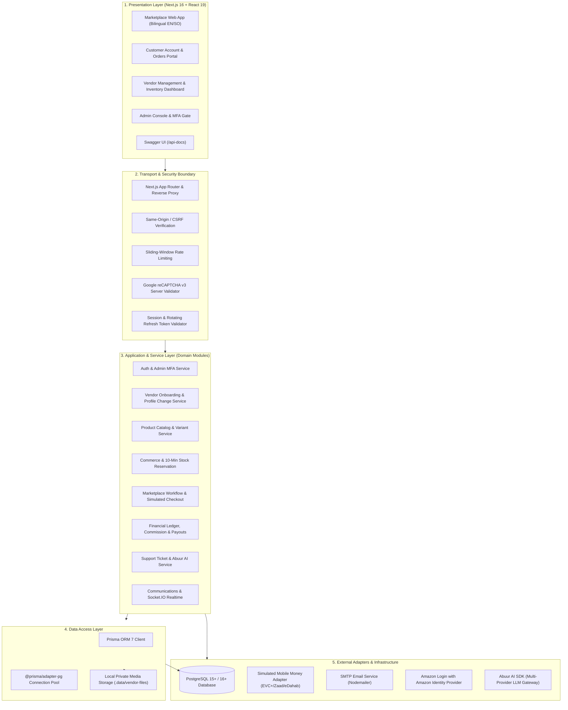

# Somsuuq System Architecture

This document describes the layered software architecture, modular structure, external integrations, and request lifecycle of the Somsuuq marketplace.

---

## 1. High-Level Layered Architecture

Somsuuq follows a clean layered design separating user presentation, HTTP routing, business logic, and database persistence:



---

## 2. Real Directory Structure & Responsibilities

```
somali-multivendor-marketplace/
├── generated/
│   └── prisma/                     # Generated Prisma 7 Client and types
├── prisma/
│   ├── migrations/                 # 22 versioned SQL migrations
│   └── schema.prisma               # 57 Prisma models, 32 enums
├── public/                         # Static assets, SVG badges, brand logos
├── scripts/
│   ├── provision-admin.ts          # CLI script to provision administrator
│   ├── seed-categories.ts          # Idempotent seed for bilingual categories
│   └── seed-commissions.ts         # Seed category commission rules
├── src/
│   ├── app/                        # Next.js 16 App Router
│   │   ├── (home)/                 # Homepage route group
│   │   ├── [locale]/               # Bilingual locale routes (/en, /so)
│   │   │   ├── admin/              # Administrator portal
│   │   │   ├── auth/               # Amazon OAuth callback
│   │   │   ├── cart/               # Shopping cart page
│   │   │   ├── checkout/           # Multi-step checkout & payment
│   │   │   ├── customer/           # Customer account, orders, tickets
│   │   │   ├── marketplace/        # Product browsing & detail pages
│   │   │   ├── vendor/             # Vendor onboarding & store dashboard
│   │   │   └── ...                 # Login, register, password reset
│   │   ├── api/                    # Route handlers
│   │   │   ├── cron/marketplace/  # Minute-interval scheduled maintenance
│   │   │   ├── locale/             # Locale preference switch
│   │   │   ├── openapi.json/       # Serves dynamic OpenAPI 3.0.3 document
│   │   │   └── v1/                 # Centralized [...segments] catch-all router
│   │   └── api-docs/               # Swagger UI page
│   ├── components/                 # React 19 UI components
│   │   ├── layout/                 # Headers, footers, navigation shells
│   │   ├── shared/                 # Data tables, pagination, status badges
│   │   └── ui/                     # shadcn/ui components (Tailwind v4)
│   ├── config/
│   │   └── env.ts                  # Centralized Zod-validated environment config
│   ├── features/                   # Domain-driven feature modules
│   │   ├── admin/                  # Overview metrics, users, audit logs
│   │   ├── ai/                     # Abuur AI multi-provider client wrapper
│   │   ├── auth/                   # Passwords, JWT, sessions, Amazon OAuth
│   │   ├── commerce/               # Orders, reservations, ledger, payouts
│   │   ├── communications/         # Chat messages, attachments, Socket.IO
│   │   ├── customer/               # Profiles, private photo uploads
│   │   ├── products/               # Products, variants, categories
│   │   ├── support/                # Tickets, messages, AI context
│   │   └── vendors/                # Storefront, onboarding applications
│   ├── i18n/                       # Somali (so) & English (en) dictionaries
│   ├── lib/
│   │   ├── api/                    # Requests, responses, and OpenAPI v1
│   │   ├── auth/                   # Password hashing, JWT signing
│   │   ├── errors/                 # AppError and error codes
│   │   ├── media/                  # Secure file upload & validation
│   │   ├── prisma.ts               # Shared PrismaClient instance
│   │   └── recaptcha/              # Client & server bot token validation
│   └── types/                      # Shared TypeScript definitions
├── tests/                          # 20 unit test suites, integration & e2e
├── server.ts                       # Custom Node HTTP server + Socket.IO
└── package.json                    # Project dependencies and npm scripts
```

---

## 3. Core Lifecycle Workflows

### A. Authentication & Session Lifespan
- Passwords hashed using **Argon2id** (memory cost 64 MB, 3 iterations).
- Sessions issue signed **JWTs** with 15-minute validity stored in HttpOnly cookies.
- A hashed refresh token in `user_sessions` allows transparent token renewal up to 30 days.

### B. 10-Minute Cart Stock Reservation
- Checkout initiation locks variant quantities using `StockReservation` with `expiresAt = NOW() + 10m`.
- The scheduled cron job (`/api/cron/marketplace`) unlocks expired reservations every minute.

### C. Multi-Vendor Order Splitting & Commission Calculation
- A customer checkout produces one `MarketplaceOrder` that is immediately partitioned into distinct `VendorOrder` records per vendor.
- Line commissions are calculated using hierarchical category inheritance:
  `OrderLine.commissionPercent` resolves to the category rate, or the parent category rate, or the platform default (default 10%).

### D. Double-Entry Financial Ledger
- The `ledger_entries` table maintains immutable credit/debit records (`SALE`, `COMMISSION`, `DELIVERY_FEE`, `REFUND`, `PAYOUT`).
- Weekly payout batches (`payout_batches`) aggregate settled vendor balances past the hold threshold (7 days post-delivery) and link them to `vendor_payouts`.
