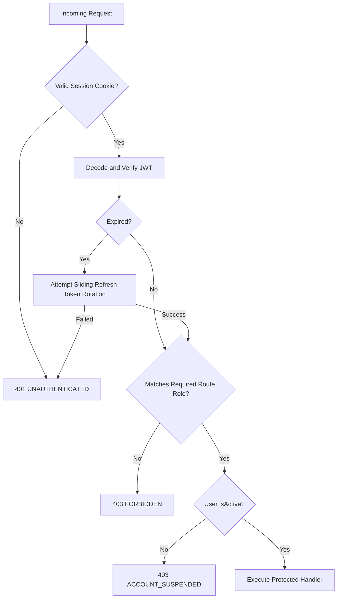

# Somsuuq Authentication & Security Architecture

This document provides a comprehensive technical guide to authentication, authorization, session management, and administrator MFA in Somsuuq.

---

## 1. Credentials & Cryptography

- **Password Hashing:** Argon2id via `argon2` (`^0.45.2`) with:
  - Memory cost: 65,536 KiB (64 MiB)
  - Iterations (time cost): 3
  - Parallelism: 4 threads
- **Token Signing:** JSON Web Tokens (JWT) signed using `jose` (`^6.2.15`) with the `HS256` algorithm using `AUTH_SECRET` (minimum 32 bytes required).
- **Admin MFA Secret Encryption:** AES-256-GCM authenticated encryption using `ADMIN_MFA_ENCRYPTION_KEY` (32 bytes encoded as 64 hex chars or 44 base64 chars).

---

## 2. Multi-Role Authorization & Role Guards

Somsuuq enforces server-side role-based access control (RBAC). The user's role is permanently stamped on their account (`AccountType`: `CUSTOMER`, `VENDOR`, or `ADMIN`) and verified cryptographically on every request.

---

## 3. Administrator MFA Gate

Platform administrators must complete a two-stage verification process:
1. **Stage 1 (Credentials & Email OTP):** Administrator submits email and password via `POST /api/v1/admin/auth/login`. A 6-digit OTP is delivered to the registered administrator email address.
2. **Stage 2 (TOTP / Recovery Code Challenge):** Upon verifying the email code (`POST /api/v1/admin/auth/email/verify`), the administrator receives a short-lived `challengeId`. They must verify their Time-based One-Time Password (TOTP) from an authenticator app (e.g., Google Authenticator) or submit a backup recovery code via `POST /api/v1/admin/auth/mfa/verify`. Only then is an administrative session cookie set.

---

## 4. Bot Protection & Rate Limiting

- **Google reCAPTCHA v3:** Evaluated on all public registration, login, password recovery, vendor onboarding submission, and simulated checkout endpoints. Tokens are checked against `RECAPTCHA_SECRET_KEY` and must meet `RECAPTCHA_MIN_SCORE` (default `0.5`).
- **Sliding-Window Rate Limiting:** Endpoint protection implemented in `src/features/auth/security.ts` tracking IP address and account identifier buckets.
