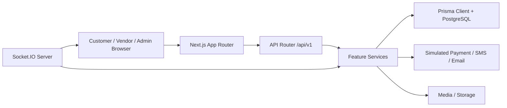
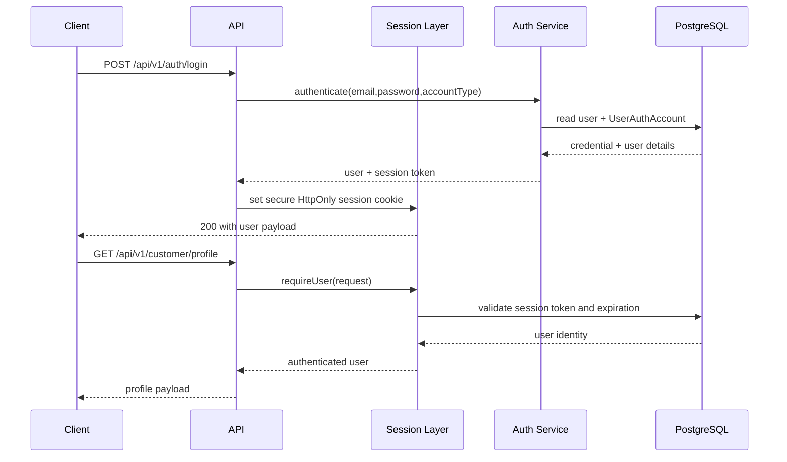
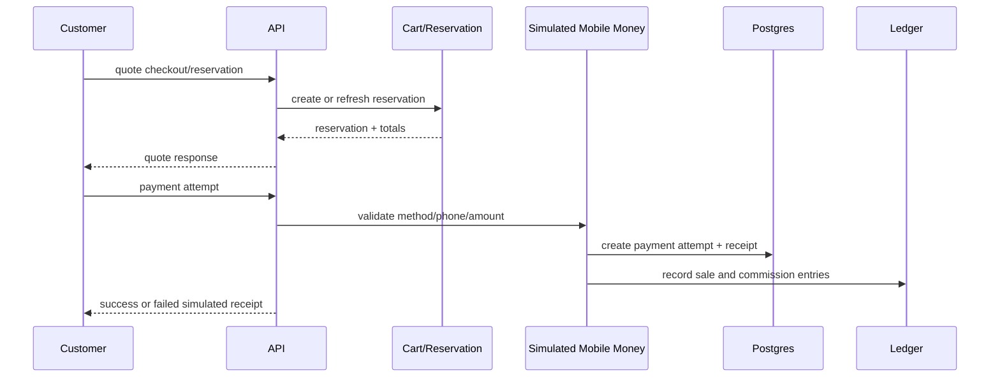
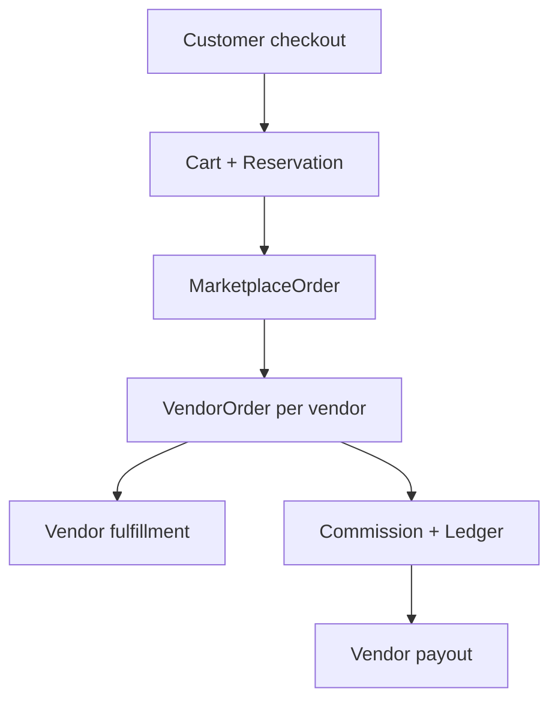
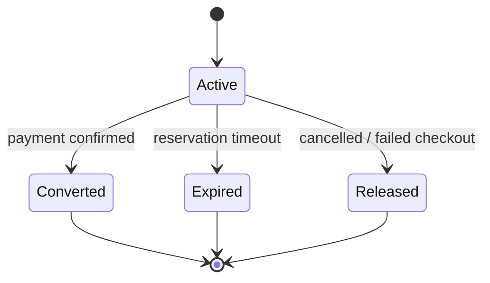
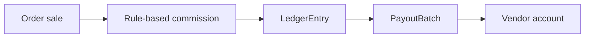
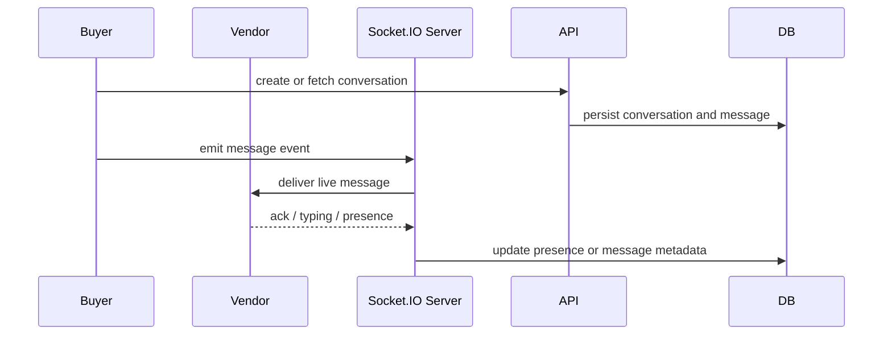

# Somsuuq Backend Architecture

This document reflects the implementation in the current repository, not a hypothetical architecture. It is synchronized with the Next.js App Router, Prisma schema, and the API route registry.

## 1. System overview

The application is a multi-vendor e-commerce backend built with:

- Next.js 16 App Router
- TypeScript
- PostgreSQL
- Prisma ORM 7
- Socket.IO for messaging and presence
- Tailwind CSS and UI components
- OpenAPI generation for `/api/openapi.json` and Swagger UI

The backend is organized around a combination of:

- route handlers in `src/app/api`
- API orchestration in `src/lib/api/v1.ts`
- service logic in `src/features/*`
- data access and Prisma models in `prisma/schema.prisma`
- runtime server setup in `server.ts`

## 2. Technology stack

| Layer | Implementation |
|---|---|
| Web server | Next.js App Router + custom Node server |
| Business logic | `src/features/*` service modules |
| Validation | Zod schemas embedded in API route registration |
| Database | PostgreSQL via Prisma Client |
| Security | Argon2 password hashing, session cookies, same-origin enforcement, MFA |
| Messaging | Socket.IO |
| API docs | OpenAPI 3.0.3 + Swagger UI |
| File handling | vendor and product media uploads under app-managed media paths |

## 3. Application architecture

## 4. Backend folder structure

- `src/app/api` – route handlers, including `/api/v1`, `/api/openapi.json`, cron, locale, and support routes
- `src/lib/api` – API response helpers, request parsing, route registration, and OpenAPI generation
- `src/features/auth` – registration, session management, MFA, OAuth, OTP flows
- `src/features/vendors` – onboarding, profile changes, approval logic
- `src/features/products` – catalogs, categories, products, media
- `src/features/commerce` – cart, checkout, inventory, returns, reviews, payments
- `src/features/support` – tickets and AI contexts
- `src/features/admin` – admin dashboard and management endpoints
- `src/lib/prisma.ts` – Prisma client access
- `server.ts` – Node runtime/server integration with Socket.IO

## 5. API architecture

The API layer uses a central router and Zod-based validation contract. Each route is registered in `src/lib/api/v1.ts` with metadata including:

- HTTP method
- path
- tags
- authentication requirement
- permission or role requirement
- request body/query schema
- response schema
- status codes

The dispatcher in `src/app/api/v1/[...segments]/route.ts` routes every request into this registry and then delegates execution to the appropriate feature service.

## 6. Authentication and authorization architecture

Important implementation details:

- Local auth uses Argon2 password hashing.
- Session tokens are hashed and stored in `user_sessions`.
- Admin MFA uses TOTP-backed `AdminMfaMethod`.
- Amazon OAuth uses PKCE state handling and a callback cookie.
- Same-origin validation is enforced on mutating requests.

## 7. Database architecture

The database schema uses a set of domain models that mirror the marketplace lifecycle:

- identity/auth: `User`, `UserAuthAccount`, `UserSession`, `AdminMfaMethod`
- onboarding: `VendorProfile`, `VendorApplicationFile`, `VendorProfileChangeRequest`
- catalog: `Category`, `Product`, `ProductVariant`, `ProductImage`
- orders: `MarketplaceOrder`, `VendorOrder`, `OrderLine`
- inventory: `StockReservation`
- finance: `LedgerEntry`, `VendorPayout`, `PayoutBatch`, `CommissionSettings`
- support: `SupportTicket`, `SupportMessage`, `SupportAttachment`
- messaging: `Conversation`, `ConversationMessage`, `ConversationPresence`

The schema is designed around several patterns:

- role-typed user identity
- vendor-owned product and order records
- immutable ledger entries for financial traceability
- reservation-based inventory safety
- event-driven support and moderation flows

## 8. Service layer architecture

Business logic lives in domain-oriented service modules under `src/features`, for example:

- `auth/service.ts` – registration, login, email verification, password reset
- `vendors/service.ts` – onboarding and application approvals
- `products/service.ts` – category and product operations
- `commerce/service.ts` – cart, order, vendor notifications, order status changes
- `commerce/marketplace-workflow.ts` – checkout reservation, mobile-money payment, reviews, coupons, returns
- `commerce/financial-service.ts` – commission rules, payout generation, reconciliation
- `support/service.ts` – support tickets and attachments

This keeps route handlers thin and ensures the API boundary remains consistent with the underlying Prisma model behavior.

## 9. Payment workflow

The payment flow is intentionally simulated and deterministic rather than a live telecom integration. This is reflected in `SimulatedPaymentMethod`, `SimulatedPaymentAttemptStatus`, and `PaymentMode`.

## 10. Multi-vendor order workflow

A customer creates one parent marketplace order, which is then split into vendor-specific sub-orders. Each vendor controls only the slice of fulfillment and accounting relevant to that store.

## 11. Inventory and stock reservation workflow

Reservations protect product inventory during checkout windows and are cleaned through scheduled jobs. The status machine is in `StockReservationStatus`.

## 12. Commission and payout workflow

Commission logic is driven by category settings and default rules, then materialized into ledger entries and payout batches for settlement.

## 13. Messaging and Socket.IO architecture

The messaging layer uses real-time events plus persisted message records. The conversation and moderation tables are separate from support tickets and represent the buyer-vendor communication surface.

## 14. Notification architecture

Notifications are stored per-user records and grouped by context:

- customer notifications
- vendor notifications
- admin notifications

These are exposed through list and mark-read endpoints and are usually triggered by order, payout, review, or support changes.

## 15. File upload and storage architecture

File attachments are handled as application-managed media records with metadata such as:

- `mimeType`
- `originalName`
- `sizeBytes`
- `storageKey`

They are used for vendor onboarding files, product images, support attachments, profile-change uploads, and conversation attachments.

## 16. Error handling and validation

The API contract relies on:

- Zod schema validation
- `AppError` domain error wrappers
- standardized error envelopes
- role and same-origin checks
- rate limits for public auth and checkout flows

This keeps request validation centralized and consistent across the route registry.

## 17. Security architecture

- password hashing via Argon2
- secure HttpOnly session cookies
- Azure/production-style host protection via same-origin enforcement
- admin MFA with TOTP and recovery codes
- email verification and password reset workflows
- route-scoped permission checks and role guards
- moderation/reporting support for abuse prevention

## 18. Deployment requirements

For a production deployment, the application expects:

- PostgreSQL database with Prisma migrations applied
- environment variables for database URL, app secret, OAuth, email, and recaptcha configuration
- persistent file storage for uploads and media keys
- Node server running in a long-lived environment for Socket.IO and API handling
- scheduled execution for stock reservation cleanup and administrative jobs

The repository includes operational scripts for admin provisioning, seed data, and Prisma generation, but the actual deployment environment still requires the correct production variables and database access.

## 19. Source of truth

The implementation is grounded in these files:

- `prisma/schema.prisma`
- `src/lib/api/v1.ts`
- `src/app/api/v1/[...segments]/route.ts`
- `src/features/**`
- `server.ts`

This document is intentionally based on the current code rather than old design assumptions.
