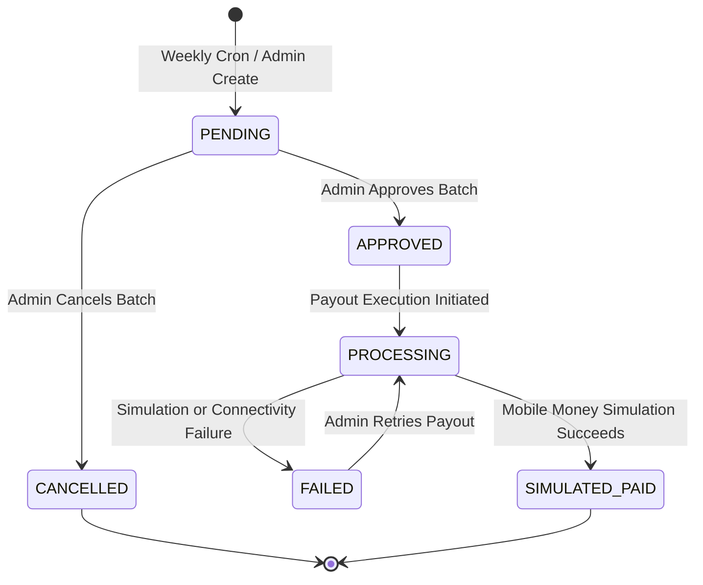

# Somsuuq Financial System & Settlement Architecture

This document describes the financial calculations, double-entry ledger, commission hierarchy, payout cycle, and reconciliation process in Somsuuq.

---

## 1. Double-Entry Accounting Principles

Every financial transaction in Somsuuq generates immutable rows in `ledger_entries`. The table acts as a general ledger for vendor balances:

$$\text{Vendor Available Balance} = \sum \text{Amount of Settled Ledger Entries} - \sum \text{Allocated Payouts}$$

### Ledger Entry Types

| Entry Type | Sign | Description |
|---|---|---|
| `SALE` | Credit (+) | Gross merchandise subtotal of a delivered sub-order. |
| `COMMISSION` | Debit (-) | Platform commission withheld from the sale. |
| `DELIVERY_FEE` | Credit (+) | Delivery fee allocated to the vendor for self-delivery. |
| `VENDOR_DISCOUNT` | Debit (-) | Vendor-funded coupon discount absorbed by the merchant. |
| `PLATFORM_DISCOUNT` | Credit (+) | Platform-funded coupon subsidy reimbursed to the vendor. |
| `REFUND` | Debit (-) | Deduction from vendor balance resulting from an accepted return. |
| `REFUND_ADJUSTMENT` | Credit (+) | Correction or partial refund reconciliation. |
| `PAYOUT` | Debit (-) | Funds disbursed to the vendor in a payout batch. |
| `ADJUSTMENT` | +/- | Administrative dispute or error correction. |

---

## 2. Commission Calculation Formula

Commission is calculated per order line at the moment a sub-order is confirmed:

$$\text{Effective Commission \%} = \begin{cases} 
\text{CategoryCommission.percent} & \text{if explicitly configured for category} \\
\text{ParentCategoryCommission.percent} & \text{if inherited from active parent} \\
\text{CommissionSettings.defaultPercent} & \text{if falling back to platform default (10\%)}
\end{cases}$$

$$\text{Line Commission Amount} = \text{round}\left( \text{unitPrice} \times \text{quantity} \times \frac{\text{Effective Commission \%}}{100}, 2 \right)$$

$$\text{Vendor Net Earnings} = \text{Subtotal} + \text{DeliveryFee} - \text{CommissionAmount} - \text{VendorDiscounts}$$

---

## 3. Weekly Payout Batch Lifecycle

1. **Batch Generation:**  
   The scheduled task creates a `PayoutBatch` for the calendar week (e.g., `2026-W45`). Eligible orders must be in status `DELIVERED` and delivered at least `holdDays` ago (default 7 days). This hold protects against post-delivery return requests.
2. **Batch Approval:**  
   An administrator inspects the payout preview table via `GET /api/v1/admin/payouts/preview` and approves the batch (`POST /api/v1/admin/payouts/batches/{id}/approve`).
3. **Execution & Allocation:**  
   The system updates payouts to `SIMULATED_PAID`, generates corresponding `LedgerEntry` rows of type `PAYOUT`, and records `PayoutAllocation` rows linking settled ledger entries to the payout.

---

## 4. Financial Reconciliation

Administrators can run the automated reconciliation tool (`GET /api/v1/admin/financial-reconciliation`), which compares:
1. **Total Cash Inflow:** $\sum \text{MarketplaceOrder.totalAmount}$ vs $\sum \text{PaymentRecord.amount}$.
2. **Gross Merchandise Volume:** $\sum \text{OrderLine.unitPrice} \times \text{quantity}$ across delivered orders vs $\sum \text{LedgerEntry(SALE)}$.
3. **Commission Accuracy:** Expected commission totals vs $\sum \text{LedgerEntry(COMMISSION)}$.
4. **Discrepancy Reporting:** Identifies unallocated entries, negative vendor balances, or mismatched transaction totals.
