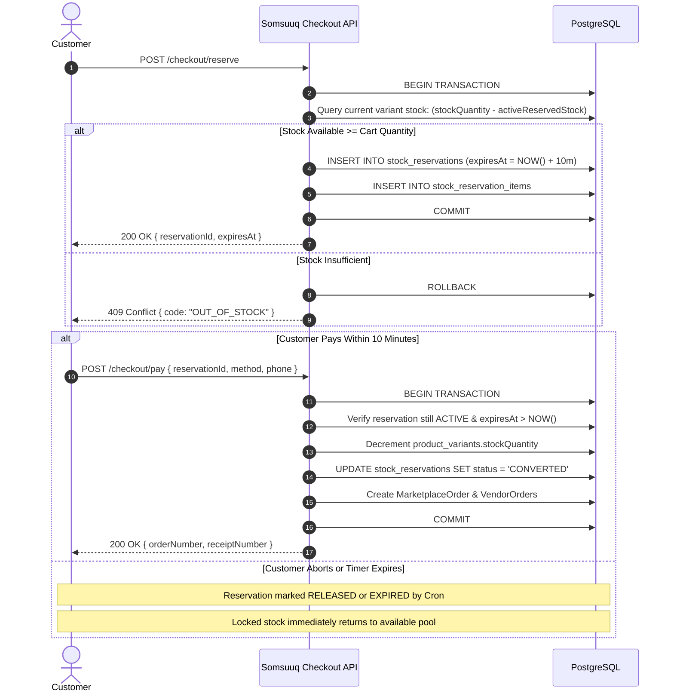
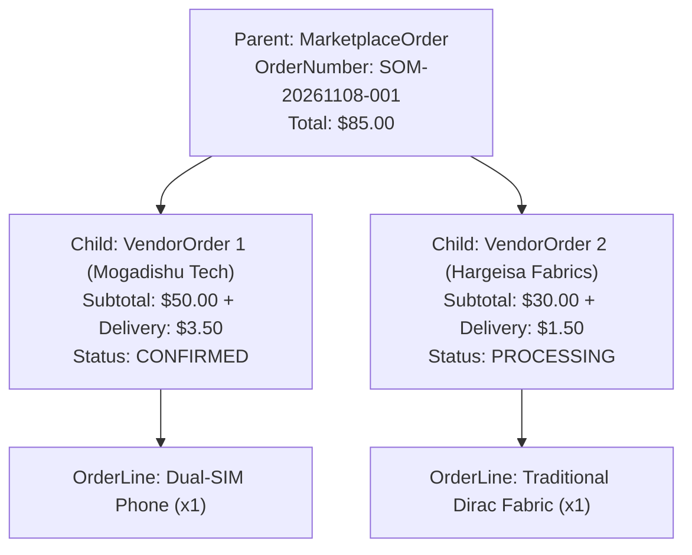

# Inventory Management & Order Fulfillment Architecture

This document explains the inventory reservation engine, the multi-vendor order structure, and the merchant fulfillment process in Somsuuq.

---

## 1. 10-Minute Optimistic Stock Reservation

To prevent overselling and inventory race conditions without blocking cart browsing, Somsuuq employs an atomic stock reservation system:

---

## 2. Parent Orders vs Vendor Sub-Orders

In a multi-vendor marketplace, a single customer order often contains items from multiple merchants located in different markets or cities across Somalia.

### Advantages of the Split Architecture:
1. **Isolated Fulfillment:** Each merchant manages only their portion of the order (`VendorOrder`). A delay by one merchant does not stall fulfillment by others.
2. **24-Hour Confirmation Deadline:** Each `VendorOrder` carries a `confirmBy` timestamp 24 hours from creation. If a merchant fails to confirm within 24 hours, the sub-order expires, protecting the customer.
3. **Independent Courier Tracking:** Merchants can assign their own courier and tracking number per sub-order.
4. **Line-Specific Returns:** Customers can request returns for individual items (`OrderLine`) without returning the entire multi-vendor order.
