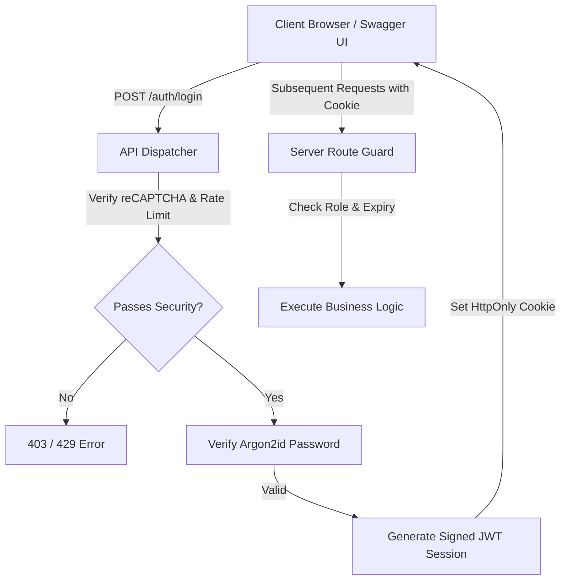
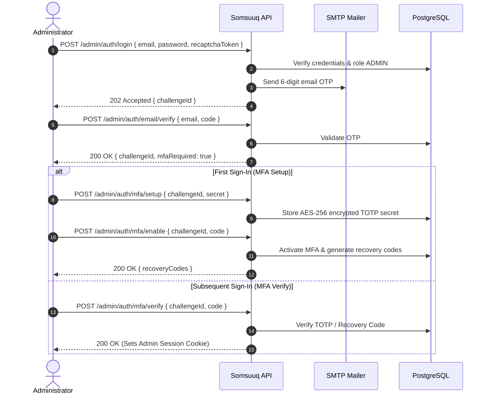

# Authentication & Authorization API Guide

Somsuuq implements an enterprise-grade multi-role authentication system that supports customers, vendors, and platform administrators with strict role boundaries, bot protection, and multi-factor authentication.

---

## 1. Authentication Architecture

---

## 2. Token & Session Management

- **Storage:** HttpOnly, SameSite (`Lax`), Secure cookies:
  - Development: `marketplace_session`
  - Production: `__Host-marketplace_session`
- **Session Lifetimes:**
  - Access Token: 15 minutes (short-lived JWT signed with `AUTH_SECRET`).
  - Refresh Token: 30 days (persisted as SHA-256 hash in `user_sessions`).
- **Sliding Renewal:** Requests to the application check session expiration. If an access JWT is expired but the refresh token hash remains valid and unrevoked, the server transparently rotates the refresh token and issues a new access cookie.

---

## 3. Customer & Vendor Authentication Flows

### A. Local Registration & Email Verification
1. `POST /api/v1/auth/customer/register` or `POST /api/v1/auth/vendor/register`
   - Request: `{ email, password, recaptchaToken }`
   - Response: `201 Created` with user representation. Sets a signed pending email verification cookie (`marketplace_pending_email_verification`).
   - A 6-digit OTP code is dispatched via SMTP (or logged in local dev).
2. `POST /api/v1/auth/email/verify`
   - Request: `{ code }` (6 digits).
   - Validates code hash against `email_verification_codes`. Upon success, marks `emailVerifiedAt = NOW()`, clears pending cookie, and sets the active session cookie.
3. `POST /api/v1/auth/email/resend`
   - Request: `{ recaptchaToken }`
   - Bound to the registered address in the pending cookie.

### B. Standard Sign-In
- `POST /api/v1/auth/login`
  - Request: `{ email, password, accountType: "CUSTOMER" | "VENDOR", recaptchaToken }`
  - Validates Argon2id hash. Rejects incorrect roles (e.g., trying to log into a vendor account as customer).

### C. Amazon Login with Amazon (OAuth 2.0 with PKCE)
- `POST /api/v1/auth/amazon`
  - Request: `{ accountType: "CUSTOMER" | "VENDOR", locale?: "en" | "so", recaptchaToken }`
  - Generates cryptographic PKCE code challenge and browser-bound state cookie.
  - Redirects (`302`) to Amazon authorization endpoint.
- `GET /api/v1/auth/amazon/callback`
  - Verifies state, exchanges code for access token using PKCE verifier, queries Amazon UserProfile API, and links/creates account.
  - Redirects (`303`) to locale customer/vendor home.

---

## 4. Administrator Authentication & MFA Architecture

Platform administrators cannot be registered publicly. They are provisioned privately via the CLI command `npm run admin:provision`.

### Key Security Attributes for Administrators
- **MFA Encryption:** TOTP secrets are encrypted at rest using AES-256-GCM (`ADMIN_MFA_ENCRYPTION_KEY`).
- **Challenge Isolation:** The `challengeId` issued after email OTP is short-lived (10 minutes) and can only be used to advance MFA; it cannot access administrator routes.
- **Audit Logging:** Every administrative login, suspension, or approval is committed to `audit_logs`.
